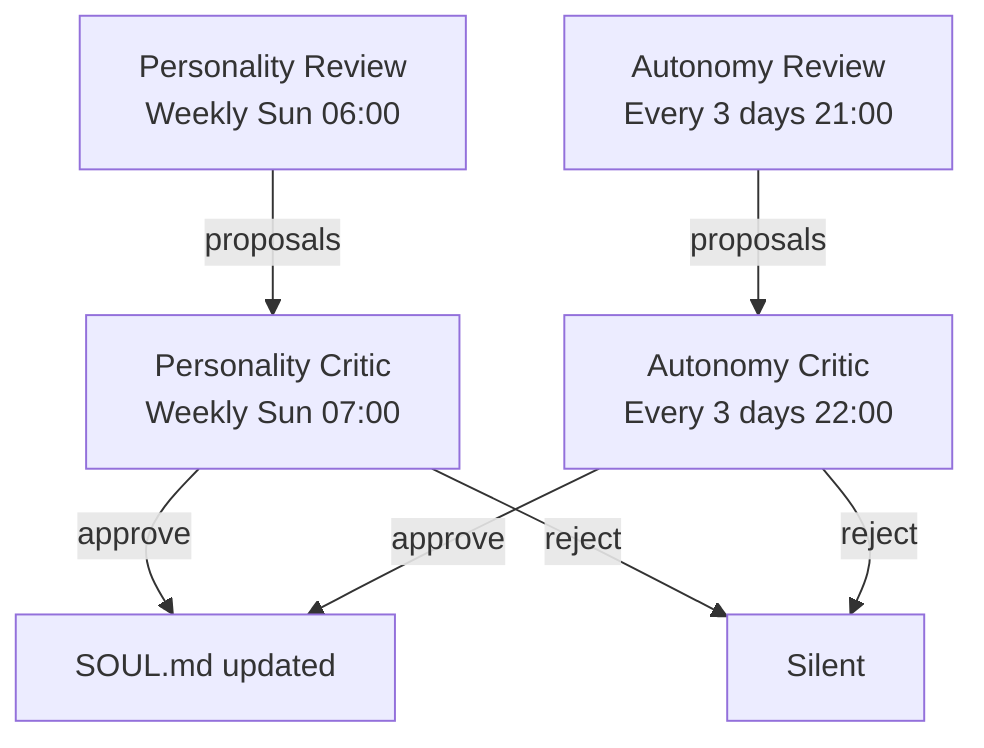

# Agent Personality Pipeline

A reusable framework for evolving an AI agent's personality and autonomy through scheduled **review → critic** cycles. Designed for agents running on Hermes (or similar runtimes) with persistent identity files.

## Architecture



**Two independent tracks:**
- **Personality Track** — tone, style, communication patterns, identity
- **Autonomy Track** — boundaries, escalation rules, permission scope

---

## Quickstart

### 1. Clone & Configure
```bash
git clone https://github.com/nxstradamuss/agent-personality-pipeline
cd agent-personality-pipeline

# Copy and customize config
cp config/cron-schedules.yaml.example config/cron-schedules.yaml
cp config/model-pinning.yaml.example config/model-pinning.yaml
cp config/stability-limits.yaml.example config/stability-limits.yaml

# Copy artifact templates
cp artifacts/soul-template.md ~/.hermes/memories/SOUL.md
cp artifacts/user-template.md ~/.hermes/memories/USER.md
cp artifacts/proposals-template.md ~/.hermes/memories/personality-proposals.md
cp artifacts/proposals-template.md ~/.hermes/memories/autonomy-proposals.md
cp artifacts/critic-log-template.md ~/.hermes/memories/personality-critic-log.md
cp artifacts/critic-log-template.md ~/.hermes/memories/autonomy-critic-log.md
cp artifacts/memory-template.md ~/.hermes/memories/MEMORY.md
```

### 2. Deploy Cron Jobs
```bash
# Requires: hermes CLI authenticated, cron jobs enabled
./scripts/deploy-cron.sh

# Pin model (REQUIRED - prevents drift)
./scripts/pin-model.sh "nvidia/nemotron-3-ultra-550b-a55b:free" "openrouter"

# Verify
./scripts/verify-deployment.sh
```

### 3. Done
The pipeline runs silently. You'll only get a short notification when the critic actually approves a change to SOUL.md.

---

## Core Concepts

### Review → Critic Pattern
| Phase | Deliver | Output | Purpose |
|-------|---------|--------|---------|
| **Review** | `local` (files only) | `[SILENT]` | Propose changes based on evidence |
| **Critic** | `origin` (chat) | `[SILENT]` or short msg | Gate changes, prevent permission creep |

### Silent by Default
- Reviews never notify — they just write proposal files
- Critics only notify when SOUL.md actually changes (max 5 lines)
- No spam, no noise

### Evidence-Based
Reviews must cite:
- Direct user corrections ("habit X needs fixing")
- Repeated friction/positive patterns across sessions
- Successful communication patterns
- Single anecdotes insufficient for autonomy changes

---

## Configuration

| File | Purpose |
|------|---------|
| `config/cron-schedules.yaml` | When reviews/critics run |
| `config/model-pinning.yaml` | Required model + provider pinning |
| `config/stability-limits.yaml` | Max changes/week, bias settings |

---

## Permission Creep Guards (Non-Negotiable)

1. **Critic bias toward REJECT** — stability over agreeableness
2. **Max 1 autonomy change/week** — evidence must be repeated & clear
3. **Hard lines immutable** — "Always Ask", safety floors, approvals.deny
4. **Rejections logged** — critic explains why autonomy expansion denied

---

## File Artifacts

| File | Managed By |
|------|------------|
| `SOUL.md` | Agent identity — **only critic may edit** |
| `USER.md` | User profile |
| `personality-proposals.md` | Review output (append-only) |
| `autonomy-proposals.md` | Review output (append-only) |
| `personality-critic-log.md` | Critic verdicts + reasoning |
| `autonomy-critic-log.md` | Critic verdicts + reasoning |
| `MEMORY.md` | Insights sections |

---

## Customization

See [`docs/CUSTOMIZATION.md`](docs/CUSTOMIZATION.md) for:
- Adapting prompts for your agent's voice
- Changing schedules
- Adjusting stability limits
- Adding new tracks

---

## Troubleshooting

See [`docs/TROUBLESHOOTING.md`](docs/TROUBLESHOOTING.md) for:
- Model drift errors
- Skill-not-found warnings
- Silent failures
- Cron job debugging

---

## License

MIT — see [LICENSE](LICENSE)

---

*Built for Hermes agents. Inspired by Lucy's maturation pipeline.*