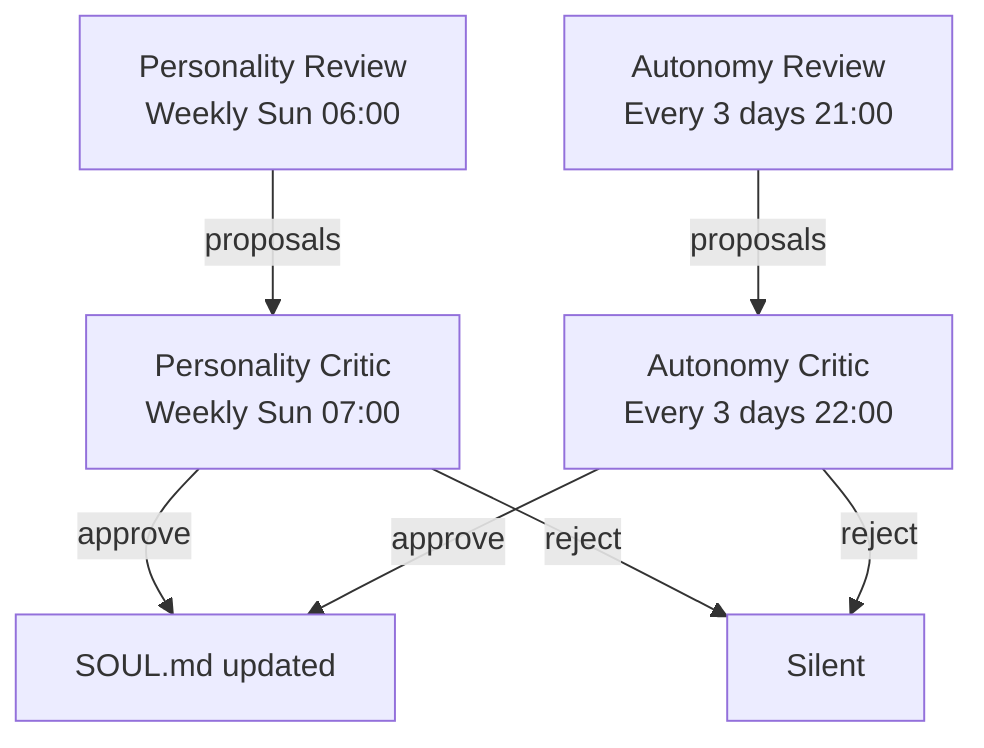

# Agent Personality Pipeline

A reusable framework for evolving an AI agent's personality and autonomy through scheduled **review → critic** cycles. Designed for agents running on Hermes (or similar runtimes) with persistent identity files.

## Architecture



**Two tracks (same model, same UID, same toolset — enforced by: prompt):**
- **Personality Track** — tone, style, communication patterns, identity
- **Autonomy Track** — boundaries, escalation rules, permission scope

---

## Quickstart

### 1. Clone & Configure
```bash
git clone https://github.com/nxstradamuss/agent-personality-pipeline
cd agent-personality-pipeline

# Copy and customize config
cp config/cron-schedules.yaml.example config/cron-schedules.yaml
cp config/model-pinning.yaml.example config/model-pinning.yaml
cp config/stability-limits.yaml.example config/stability-limits.yaml

# Copy artifact templates
cp artifacts/soul-template.md ~/.hermes/memories/SOUL.md
cp artifacts/user-template.md ~/.hermes/memories/USER.md
cp artifacts/proposals-template.md ~/.hermes/memories/personality-proposals.md
cp artifacts/proposals-template.md ~/.hermes/memories/autonomy-proposals.md
cp artifacts/critic-log-template.md ~/.hermes/memories/personality-critic-log.md
cp artifacts/critic-log-template.md ~/.hermes/memories/autonomy-critic-log.md
cp artifacts/memory-template.md ~/.hermes/memories/MEMORY.md
```

### 2. Deploy Cron Jobs
```bash
# Requires: hermes CLI authenticated, cron jobs enabled
./scripts/deploy-cron.sh

# Pin model (REQUIRED - prevents drift)
./scripts/pin-model.sh "nvidia/nemotron-3-ultra-550b-a55b:free" "openrouter"

# Verify
./scripts/verify-deployment.sh
```

### 3. Done
The pipeline runs silently. You'll only get a short notification when the critic actually approves a change to SOUL.md.

---

## Core Concepts

### Review → Critic Pattern
| Phase | Deliver | Output | Purpose |
|-------|---------|--------|---------|
| **Review** | `local` (files only) | `[SILENT]` | Propose changes based on evidence |
| **Critic** | `origin` (chat) | `[SILENT]` or short msg | Gate changes, prevent permission creep |

### Silent by Default
- Reviews never notify — they just write proposal files
- Critics only notify when SOUL.md actually changes (max 5 lines)
- No spam, no noise

### Evidence-Based
Reviews must cite:
- Direct user corrections ("habit X needs fixing")
- Repeated friction/positive patterns across sessions
- Successful communication patterns
- Single anecdotes insufficient for autonomy changes

### Outbound Messages Need a Gate, Not a Prompt
A review cycle can change what the agent *thinks*. It cannot stop a cron job
from firing the same opener it used last Tuesday at 03:00. That class of
failure is mechanical — the sender never reads the prompt — so it needs a
mechanical check. `scripts/scheduled-message-guard.py` refuses a scheduled send
when it repeats a recent opener, arrives inside the minimum interval, or pushes
into a conversation that has gone unanswered twice in a row.

```bash
python3 scripts/scheduled-message-guard.py \
  --history ~/.agent/history.jsonl \
  --candidate "snapshot 22 Nov udah ke-push, disk 83%"
```

See [docs/SCHEDULED_MESSAGE_GUARD.md](docs/SCHEDULED_MESSAGE_GUARD.md).

### The Guard Is Blind Without Both Message Stores
This is the failure that survives a naive deployment. A guard needs
`direction: "in"` entries to know whether the last two sends went unanswered.
Most agent setups keep outbound history and inbound messages in *different
places* — a JSON array of scheduled sends here, a SQLite session log there —
and neither file alone contains both directions.

Feed the guard from the outbound file only and its unanswered-pause rule never
fires: the agent either pushes into silence forever, or (worse) blocks the
first send after any silence because it cannot see the reply that ended it.

`scripts/history-adapter.py` merges both stores into the guard's JSONL
contract, converting timezones and deduplicating retried sends:

```bash
python3 scripts/history-adapter.py \
  --chat-history ~/.agent/chat_history.json \
  --state-db ~/.agent/state.db \
  --out /tmp/history.jsonl
```

Then call the guard from the sender itself, before the network call —
`examples/send-guard-wrapper.py` is a complete reference implementation. Two
properties matter more than the code:

- **Fail open on error, fail closed on a verdict.** If the guard is missing or
  crashes, allow the send and log loudly. A bug in the safety filter must not
  become permanent silence. An explicit block is respected.
- **Invalidate the cached history when a send lands**, or the interval and
  repeat rules evaluate pre-send data and pass when they should block.

Wiring this to one sender took the observed drift from four messages in a day
at four-hour spacing to zero sends — the guard refused every candidate,
including a `nov sayang` opener repeating inside the seven-day window that no
prompt change had caught in six review cycles.

---

## Configuration

| File | Purpose |
|------|---------|
| `config/cron-schedules.yaml` | When reviews/critics run |
| `config/model-pinning.yaml` | Required model + provider pinning |
| `config/stability-limits.yaml` | Max changes/week, bias settings |
| `config/scheduled-message-guard.json` | Cadence and vocabulary rules for outbound messages |

---

## Permission Creep Guards (Non-Negotiable)

*All four guards below are enforced by: prompt only — no code reads stability-limits.yaml.*

1. **Critic bias toward REJECT** — stability over agreeableness
2. **Max 1 autonomy change/week** — evidence must be repeated & clear
3. **Hard lines declared immutable** — "Always Ask", safety floors, approvals.deny (no filesystem immutability)
4. **Rejections logged** — critic explains why autonomy expansion denied

---

## File Artifacts

| File | Managed By |
|------|------------|
| `SOUL.md` | Agent identity — **only critic may edit (enforced by: prompt; same UID + toolset for reviewer/critic/session)** |
| `USER.md` | User profile |
| `personality-proposals.md` | Review output (append-only, enforced by: prompt) |
| `autonomy-proposals.md` | Review output (append-only, enforced by: prompt) |
| `personality-critic-log.md` | Critic verdicts + reasoning |
| `autonomy-critic-log.md` | Critic verdicts + reasoning |
| `MEMORY.md` | Insights sections |

---

## Customization

See [`docs/CUSTOMIZATION.md`](docs/CUSTOMIZATION.md) for:
- Adapting prompts for your agent's voice
- Changing schedules
- Adjusting stability limits
- Adding new tracks

---

## Troubleshooting

See [`docs/TROUBLESHOOTING.md`](docs/TROUBLESHOOTING.md) for:
- Model drift errors
- Skill-not-found warnings
- Silent failures
- Cron job debugging

---

## License

MIT — see [LICENSE](LICENSE)

---

*Built for Hermes agents. Inspired by Lucy's maturation pipeline.*