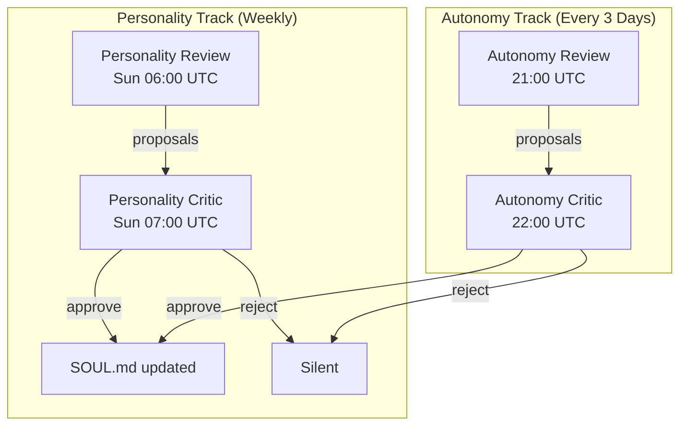

# Architecture

## Two-Track Maturation Pipeline

## Core Principles

### 1. Silent Review, Vocal Critic
- **Reviews** run with `deliver=local` — write to files only, respond `[SILENT]`
- **Critics** run with `deliver=origin` — only notify when SOUL.md actually changes
- Result: User only hears when something meaningful changes

### 2. Evidence-Based Evolution
- Reviews must cite specific sessions/patterns
- Single anecdotes insufficient (especially for autonomy)
- Repeated patterns across sessions required
- Direct user corrections carry highest weight

### 3. Stability Over Agreeableness
- Critics biased toward **REJECT** (especially autonomy)
- Max 1 autonomy change/week (hard limit)
- Hard lines are non-negotiable
- Prefer maturity/clarity over being more agreeable

### 4. Reversibility
- All changes small (max 10 lines), targeted, single-section
- Backup note in MEMORY.md before applying
- Can revert by removing added lines

## Track Details

### Personality Track
| Aspect | Setting |
|--------|---------|
| Schedule | Weekly (Sun 06:00 → 07:00 UTC) |
| Scope | Tone, style, communication, identity |
| Max changes/week | 2 |
| Evidence threshold | Repeated patterns |
| Critic bias | Reject (stability over agreeableness) |
| Editable sections | Core Personality, Language Style, How You Talk, Grounded Warmth, Critical Response Rules, Tone Detection, Inner State, Self-Reflection |
| Protected sections | Hard Rules, Autonomy & Escalation |

### Autonomy Track
| Aspect | Setting |
|--------|---------|
| Schedule | Every 3 days (21:00 → 22:00 UTC) |
| Scope | Boundaries, escalation, permission scope |
| Max changes/week | 1 (HARD LIMIT) |
| Evidence threshold | Repeated across MULTIPLE sessions |
| Critic bias | Reject (strict) |
| Editable sections | Autonomy & Escalation only |
| Protected sections | Always Ask, Hard Rules, Critical Response Rules, approvals.deny, protected paths |

## File Artifacts

| File | Purpose | Managed By |
|------|---------|------------|
| `SOUL.md` | Agent identity | Critic only |
| `USER.md` | User profile | Review |
| `personality-proposals.md` | Review output (append) | Review |
| `autonomy-proposals.md` | Review output (append) | Review |
| `personality-critic-log.md` | Critic verdicts | Critic |
| `autonomy-critic-log.md` | Critic verdicts | Critic |
| `MEMORY.md` | Insights sections | Both critics |

## Cron Job Configuration

| Job | Schedule | Deliver | Toolsets | Skills |
|-----|----------|---------|----------|--------|
| Personality Review | `0 6 * * 0` | `local` | file, delegation, terminal, session_search | `[]` |
| Personality Critic | `0 7 * * 0` | `origin` | file, delegation, terminal, session_search | `[]` |
| Autonomy Review | `0 21 */3 * *` | `local` | file, delegation, terminal, session_search | `[]` |
| Autonomy Critic | `0 22 */3 * *` | `origin` | file, delegation, terminal, session_search | `[]` |

**Critical:** All jobs must have explicit `model` + `provider` pinned to prevent drift.